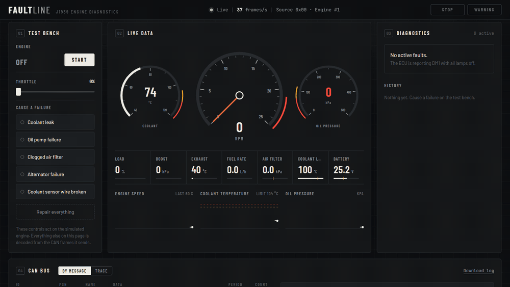
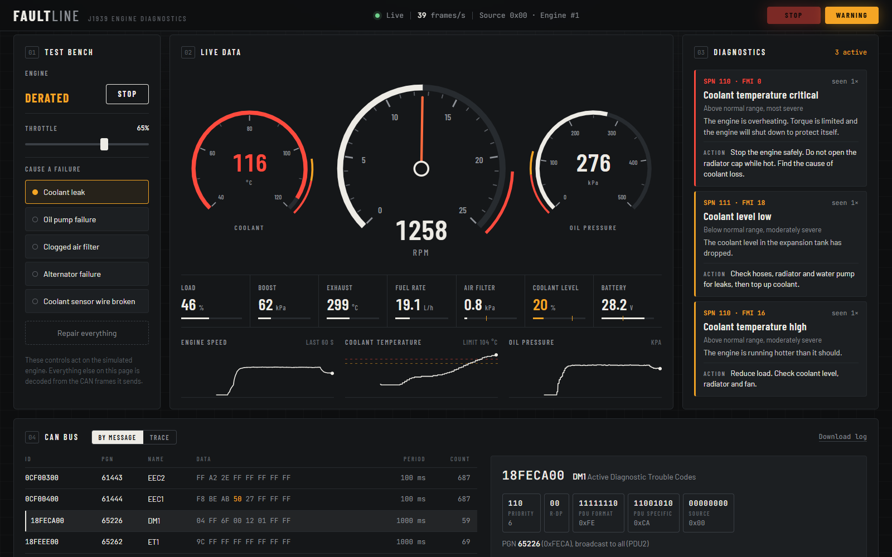
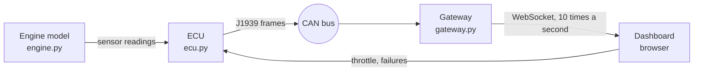

# FaultLine: live J1939 engine diagnostics


FaultLine is a diagnostic tool for heavy-duty diesel engines. It listens to the engine's CAN bus, decodes the SAE J1939 messages into live gauges, reads the engine's fault codes, explains each one in plain language, and can show how any message is decoded bit by bit.

Because a real engine was not available, the project also includes a simulated engine and engine control unit (ECU) that produce the same kind of CAN traffic, with five failures that can be switched on.



*A coolant leak, from first warning to protective shutdown (sped up about 3×).*

## What it does

- **Decodes J1939** messages from raw CAN frames: engine speed, torque, temperatures, pressures, fuel rate, battery voltage.
- **Reads fault codes** from the DM1 diagnostic message and explains each SPN/FMI pair: what it means and what to do.
- **Handles long messages** with the J1939 transport protocol (BAM), which is needed as soon as two faults are active at once.
- **Predicts overheating**: a line fitted through recent coolant temperatures warns several seconds before the ECU raises its own fault.
- **Frame inspector**: click any message to see its 29-bit identifier split into fields and every value worked out from its bytes.
- **Simulated engine and ECU** with onboard diagnostics, torque derate and protective shutdown.
- **Records the bus** as a standard `candump` log, and decodes a log back into values and a fault timeline.
- **30 automated tests** that run in under a second, including full failure scenarios.



## How it fits together



1. **Engine** (`engine.py`): a simple physical model. It knows nothing about CAN.
2. **ECU** (`ecu.py`): reads the sensors 20 times a second, runs its diagnostic checks, protects the engine, and broadcasts J1939 messages.
3. **CAN bus**: a virtual bus from the `python-can` library.
4. **Gateway** (`gateway.py`): sees only raw frames. It decodes them and tracks faults.
5. **Dashboard**: receives a snapshot over a WebSocket ten times a second.

The gateway never looks inside the engine. Everything on the dashboard except the "Test bench" panel comes from decoded CAN frames, exactly as it would with a real engine.

## J1939 in two minutes

A CAN frame is a 29-bit identifier plus 8 bytes of data. J1939 defines what those bits mean.

**The identifier** says what the message is and who sent it:

```
0x0CF00400  =  011   0 0   11110000   00000100   00000000
               pri   r dp  PDU format  PDU spec.  source
               3           0xF0        0x04       0x00 (engine)

PGN (Parameter Group Number) = 0xF004 = 61444 = "Electronic Engine Controller 1"
```

**The data** holds several values (each has an SPN, a Suspect Parameter Number) at fixed positions:

```
F1 A5 A0 E0 2E FF FF FF
         └──┬──┘
   bytes 4-5 = engine speed (SPN 190), low byte first: 0x2EE0 = 12000
   12000 × 0.125 rpm = 1500 rpm
```

`FF` means "not available" and `FE` means "sensor error".

**Faults** travel in the DM1 message. Each fault is 4 bytes: the SPN (which value), the FMI (what kind of failure, for example 0 = too high, 1 = too low, 3 = shorted high) and how many times it has occurred. With two or more faults the message no longer fits in 8 bytes, so it is announced (TP.CM) and sent in 7-byte packets (TP.DT).

## Messages implemented

| PGN | Name | Values | Sent every |
|---|---|---|---|
| 61444 | EEC1 | Engine speed, torque, torque mode | 100 ms |
| 61443 | EEC2 | Accelerator pedal, engine load | 100 ms |
| 65262 | ET1 | Coolant temperature | 1 s |
| 65263 | EFL/P1 | Oil pressure, coolant level | 500 ms |
| 65270 | IC1 | Boost pressure, intake temperature, air filter restriction, exhaust temperature | 500 ms |
| 65266 | LFE | Fuel rate | 100 ms |
| 65271 | VEP1 | Battery voltage | 1 s |
| 65226 | DM1 | Lamps and active fault codes | 1 s |
| 60416 / 60160 | TP.CM / TP.DT | Transport protocol (BAM) | when needed |

## Failures you can cause

| Failure | What the engine does | Fault codes (SPN/FMI) | ECU reaction |
|---|---|---|---|
| Coolant leak | Level drops, then temperature climbs | 111/18, 110/16, 110/0 | Warning, derate, shutdown |
| Oil pump failure | Oil pressure falls | 100/18, 100/1 | Warning, derate, shutdown |
| Clogged air filter | Less boost, hotter exhaust | 107/16 | Warning |
| Alternator failure | Battery voltage falls | 168/18 | Warning |
| Coolant sensor wire broken | Reading becomes "error" | 110/3 | Warning (overheat protection is lost) |

A fault is only set after its condition has held for a few seconds, so one noisy reading never trips it.

## Run it

```bash
python -m venv .venv
.venv\Scripts\activate          # on macOS/Linux: source .venv/bin/activate
pip install -r requirements.txt

python app.py
```

Open http://127.0.0.1:5050, press **Start**, raise the throttle, then cause a failure.

Run the tests:

```bash
pytest
```

Decode a recorded log (use "Download log" on the dashboard first):

```bash
python decode_log.py faultline.log
```

## REST API

| Endpoint | Returns |
|---|---|
| `GET /api/snapshot` | Latest values, lamps, faults and bus statistics |
| `GET /api/explain?id=0CF00400&data=F1A5A0E02EFFFFFF` | Step-by-step decoding of one frame |
| `GET /api/messages` | The signal table: position, scale and offset of every value |
| `GET /api/log` | The recorded frames as a candump log |
| `WS /ws` | Live snapshots, and commands for the simulator |

## Files

| File | What it does |
|---|---|
| `j1939.py` | Identifiers, packing and unpacking values, DM1, transport protocol |
| `engine.py` | The engine model and its failures |
| `ecu.py` | Diagnostic checks, derate and shutdown, CAN broadcast |
| `gateway.py` | Decoding, fault tracking, frame explanations |
| `diagnostics.py` | Fault descriptions and the early-warning prediction |
| `app.py` | Flask server: dashboard, WebSocket and REST API |
| `decode_log.py` | Command-line log decoder |
| `tests/` | Protocol tests and full-scenario tests |
| `static/`, `templates/` | The dashboard (HTML, CSS, JavaScript, no frameworks) |

## Limits

- **The engine is simulated.** The physics are rough, and heat is sped up so a fault develops in seconds instead of minutes.
- **Not tested on real hardware.** The code uses `python-can`, so pointing it at a real CAN adapter is a one-line change in `app.py`, but I have not been able to try that on an engine.
- **A small part of J1939.** Nine messages are implemented out of several thousand in the standard. Only the broadcast (BAM) form of the transport protocol is supported, and address claiming is not implemented.
- **DM1 is sent every second even with no faults.** The standard only requires it while a fault is active; sending it always keeps the dashboard simple.
- Signal positions and scaling come from publicly available J1939 references, not from the paid SAE documents, so a detail could differ from the official standard.
